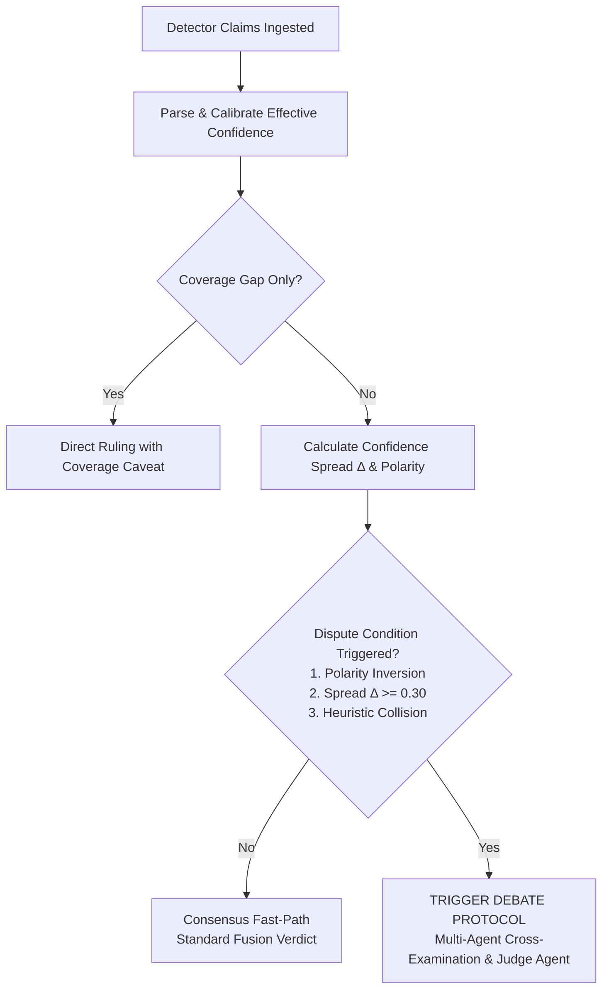

# AEGIS Debate & Arbitration Protocol for Conflicting Video Evidence

**Document Version:** 1.0.0  
**Status:** Approved Architecture Specification (Month 2 Core Deliverable)  
**Author:** AEGIS AI & Forensic Architecture Team  
**Supervisors:** Dr. Amr Megahed, Eng. Ramez Yousri  
**Target Services:** `debate/`, `orchestrator/`, `security/`  
**Related Specifications:**  
- `shared/json-api-contracts-schema/claim_evidence_schema.json`  
- `docs/LIMITATIONS.md`  
- `capability_manifests/{video-classifier,rppg,syncnet}.json`  
- `security/docs/incident_response_workflow.md`  
- `docs/month1_ai_track_summary.md`  

---

## 1. Executive Summary & Problem Formulation

In Month 1 of AEGIS, three distinct video detection microservices were deployed:
1. **`video-classifier`**: EfficientNet-B0 frame-level classifier detecting spatial boundary and frequency anomalies.
2. **`rppg`**: CHROM pulse extraction analyzing temporal biological micro-color variations (blood volume pulse).
3. **`syncnet`**: Audio-visual lip-phoneme synchronization model (*reused as-is from Month 1, not modified further*).

During Month 1 benchmarking (120-sample pipeline benchmark reported in `docs/month1_ai_track_summary.md`), the baseline orchestrator relied on a static heuristic weighted average (`orchestrator/app/aggregate.py`):
$$\text{Score} = \frac{1.5 \cdot c_{\text{classifier}} + 1.2 \cdot c_{\text{rppg}} + 1.2 \cdot c_{\text{syncnet}}}{1.5 + 1.2 + 1.2}$$

This naive mathematical averaging exposed four critical systemic vulnerabilities:
1. **Statistically Unreliable Signals Distorting the Ensemble**: `rPPG` achieved only a **10.0% agreement** with the pipeline consensus, yet was assigned a heavy 1.2× static weight.
2. **The Score Inversion Trap**: When environmental degradation occurred (e.g., mean luminance < 40/255 or clips < 2.0s), `rPPG` failed to extract a cardiac pulse signal, yielding a spectral purity of 0.0. The naive formula ($1.0 - \text{purity}$) mapped this zero-signal state to a **100% synthetic assertion**, generating catastrophic false positives on authentic dark videos.
3. **Blinding Disagreement into "Uncertain"**: When the `video-classifier` asserted high-confidence manipulation ($c = 0.92$) and `rPPG` asserted authentic biological signs ($c = 0.15$), the weighted average output an ambiguous score ($0.57 \rightarrow \text{UNCERTAIN}$), failing to identify *why* the signals conflicted or which detector was compromised.
4. **Failure to Satisfy Legal Chain-of-Custody**: In forensic litigation, a court cannot accept a bare numeric probability ($0.57$). The legal system requires an auditable **Chain of Evidence**, explaining what physical or algorithmic discrepancies were observed, which limitations applied, and the rational deduction leading to the verdict.

This document specifies the **AEGIS Debate & Arbitration Protocol** (Month 2), establishing how claims are formatted, how disagreement thresholds are mathematically triggered, and how a specialized **Judge Agent** renders an auditable, court-admissible final verdict with full justification.

---

## 2. Characterization of the Three Video Detectors

The arbitration layer must understand the intrinsic physics, algorithmic mechanisms, and known failure boundaries of each Month 1 video detector:

| Detector | Modality Domain | Primary Target Artifact | Normal Output Range | Known Failure Modes (from `docs/LIMITATIONS.md`) |
| :--- | :--- | :--- | :--- | :--- |
| **`video-classifier`** | `spatial_pixel` | Blending boundaries, frequency residuals, warping artifacts | $c \in [0.0, 1.0]$<br/>$0.0 = \text{Real}, 1.0 = \text{Fake}$ | **High Compression**: Heavy social media re-encoding blurs boundary residuals.<br/>**Demographics**: Skewed on out-of-distribution skin tones.<br/>**Frame Variance**: Deepfakes affecting only a subset of frames can be diluted by whole-video averaging. |
| **`rppg`** (CHROM) | `physiological_bvp` | Absence or irregularity of biological pulse signal (cardiac rhythm) | $c \in [0.0, 1.0]$<br/>Estimated BPM $[40, 180]$ | **Low Light**: Mean luminance $< 40/255$ causes sub-pixel color signal collapse.<br/>**Short Duration**: Clips $< 2.0$s prevent Butterworth filter convergence.<br/>**Face Occlusion**: $< 12\%$ skin ratio causes false periodic sampling of non-skin objects.<br/>**Face-Swap Preservation**: High-end face-swaps can retain source actor cardiac pulse. |
| **`syncnet`** *(As-Is)* | `audiovisual_sync` | Desynchronization between visual lip articulation and acoustic phonemes | $c \in [0.0, 1.0]$<br/>Offset $[-15, +15]$ frames | **Silent Video**: Cannot evaluate without audio track (`not_applicable`).<br/>**Foreign Dubbing**: Professional dubbing/translation causes natural desync on authentic footage.<br/>**Lower Face Occlusion**: Masks or hands blocking the mouth prevent landmark extraction. |

---

## 3. Claim & Evidence Data Contract

All detectors feeding into the arbitration layer must emit rich, typed evidence conforming to `shared/json-api-contracts-schema/claim_evidence_schema.json`.

### 3.1 Structural Components of a Claim

```
┌────────────────────────────────────────────────────────────────────────┐
│                             ForensicClaim                              │
├────────────────────────────────────────────────────────────────────────┤
│ • Identity: claim_id, job_id, detector_id, model_version               │
│ • Domain: EvidenceDomain (spatial_pixel, physiological_bvp, av_sync)   │
│ • Classification: ClaimPolarity (AUTHENTIC, SYNTHETIC, INCONCLUSIVE)   │
│ • Scores: confidence [0-1], raw_score (unnormalized metric)            │
│ • Narrative: human-readable claim string                               │
│ • Diagnostic Flags: List[str] (e.g. "low_light_attenuation")           │
│ • Observational Metrics:                                               │
│     - Spatial: sampled_frames, max_frame_anomaly, frame_variance       │
│     - Physiological: estimated_bpm, spectral_purity, skin_ratio        │
│     - AudioVisual: optimal_offset_frames, offset_ms, min_distance      │
│ • Attenuation Factors: luminance, duration, occlusion, compression     │
│ • Forensic Audit: evidence_hash (SHA-256), ISO timestamp               │
└────────────────────────────────────────────────────────────────────────┘
```

### 3.2 Environmental Confidence Attenuation Formula

Before entering the debate matrix, each raw confidence score $c_{\text{raw}}$ is calibrated by the detector's environmental attenuation factor:

$$\alpha_{\text{composite}} = \min(\alpha_{\text{lum}}, \alpha_{\text{dur}}, \alpha_{\text{occ}}, \alpha_{\text{comp}}) \in [0.0, 1.0]$$

$$c_{\text{effective}} = 0.5 + (c_{\text{raw}} - 0.5) \cdot \alpha_{\text{composite}}$$

- When operating under ideal conditions ($\alpha_{\text{composite}} = 1.0$), $c_{\text{effective}} = c_{\text{raw}}$.
- Under severe environmental degradation (e.g. low-light where $\alpha_{\text{lum}} = 0.10$), $c_{\text{effective}}$ collapses toward neutral $0.50$, preventing the detector from claiming high certainty on corrupted inputs.

---

## 4. Disagreement Metrics & Trigger Thresholds

The arbitration engine dynamically routes incoming claims along one of two operational pathways:
1. **Consensus Fast-Path**: When detectors agree within acceptable tolerance, avoiding LLM overhead ($< 10$ms).
2. **Arbitration Protocol**: Triggered immediately when any disagreement condition is satisfied.



### 4.1 Trigger Conditions

#### Trigger 1: Polarity Inversion (Hard Conflict)
Occurs when one active detector asserts synthetic manipulation while another asserts authentic human presence:
$$\exists i, j \text{ such that } \text{Polarity}_i = \text{SYNTHETIC} \land \text{Polarity}_j = \text{AUTHENTIC}$$
Or in numeric terms:
$$(c_i \ge 0.65) \land (c_j \le 0.35)$$

#### Trigger 2: Confidence Spread Threshold Exceeded
Occurs when all detectors lean toward the same direction, but their variance reveals significant diagnostic instability:
$$\Delta = \max_{i, j} |c_i - c_j| \ge \Delta_{\text{thresh}} = 0.30$$

#### Trigger 3: Heuristic Collision
Occurs when diagnostic flags point to incompatible physical realities:
- `video-classifier` emits `flags: ["high_fake_probability"]` while `syncnet` emits `flags: ["lip_sync_verified"]` on a talking-head clip.
- `rppg` emits `flags: ["atypical_heart_rate"]` ($BPM > 160$) on a stationary resting subject, conflicting with `video-classifier` asserting `authentic_frames`.

### 4.2 Distinguishing True Conflict vs. Coverage Gaps

An essential innovation over Month 1 is distinguishing **True Model Disagreements** from **Benign Coverage Gaps**:
- **Coverage Gap**: `syncnet` returning `not_applicable` on silent video, or `rppg` returning `insufficient_duration` on a 0.8s clip.
  - *Action*: **Do not trigger adversarial debate.** The inactive detector is marked as a known blind spot; the active detector's claim is accepted with an explicit coverage warning in the final audit trail.
- **True Conflict**: Both `video-classifier` and `rppg` have active, valid signals on a 10s video, but reach opposing conclusions.
  - *Action*: **Trigger Full Arbitration Protocol.**

---

## 5. The Structured Debate Protocol

When a dispute is triggered, the Arbitration Engine constructs a structured cross-examination environment.

```
┌────────────────────────────────────────────────────────────────────────┐
│                        Structured Debate Flow                          │
├────────────────────────────────────────────────────────────────────────┤
│ Round 1: Claim Submissions                                             │
│   Each detector's advocate agent presents:                             │
│   - Primary claim, observed metrics, triggered flags                   │
│   - Operating conditions (luminance, duration, face/audio presence)    │
│                                                                        │
│ Round 2: Automated Cross-Examination & Context Injection               │
│   The engine queries detector manifests and LIMITATIONS.md:            │
│   - Check 1: Were detector operating constraints violated?            │
│   - Check 2: Does the signal match a known systematic failure mode?   │
│   - Check 3: Is there a multi-modal conflict (e.g. face swap with     │
│              intact background or dubbed audio)?                       │
│                                                                        │
│ Round 3: Adjudication & Forensic Ruling                                │
│   Judge Agent evaluates cross-examination findings and issues:         │
│   - Categorical Verdict: AUTHENTIC | SYNTHETIC | INTEGRITY_UNKNOWN     │
│   - Claim Adjudications (which evidence was discounted and why)       │
│   - Court-Admissible Chain-of-Evidence Narrative                       │
│   - Cryptographic Evidence Manifest Hash (SHA-256)                     │
└────────────────────────────────────────────────────────────────────────┘
```

### 5.1 Evidence Hierarchy Rules (The Forensic Precedence Matrix)

The Judge Agent evaluates claims under a strict hierarchy of forensic authority:

$$\text{Integrity / Cyber Proof} \gg \text{Physical / Physiological} \gg \text{Spatial Artifacts} \gg \text{Statistical Heuristics}$$

1. **Rule of Environmental Invalidation**:
   If `OperatingConditions.mean_luminance < 40/255`, any `rppg` claim of synthetic manipulation based on low spectral purity is **invalidated** (discounted by 90%), because environmental darkness causes signal loss that mimics synthetic flatness.
2. **Rule of Face-Swap Pulse Preservation**:
   If `video-classifier` detects high spatial warping ($c > 0.85$, boundary artifacts) while `rppg` detects normal cardiac pulse ($BPM \approx 72$, authentic), the Judge Agent recognizes **Face-Swap Inpainting**. The authentic pulse originates from the unmodified host body in the video background, while the face boundary is synthetic. **Verdict: SYNTHETIC.**
3. **Rule of Language / Narration Dubbing**:
   If `syncnet` reports severe lip-audio desync ($offset \ge 4$ frames) on content with natural face dynamics and zero spatial artifacts, the Judge Agent checks for foreign translation or voiceover. If audio is non-speech or translation-dubbed, the lip-sync desync is ruled as post-production dubbing, not video manipulation. **Verdict: AUTHENTIC (with Dubbing Note).**
4. **Rule of Absolute Non-Default to Authentic**:
   If input quality is degraded across all channels (e.g. low light + silent audio + low resolution), the system **MUST NEVER** default to `AUTHENTIC`. Per Dr. Amr’s strict requirement, the verdict must be **`INTEGRITY_UNKNOWN`**.

---

## 6. The Judge Agent Architecture

AEGIS implements a **Dual-Mode Judge Architecture**:
- **Agentic LLM Judge**: Uses structured Chain-of-Thought prompting over injected manifests for nuanced cloud/server deployments.
- **Deterministic Expert Arbiter**: Fully standalone, zero-latency Python decision engine for edge deployments (NVIDIA Jetson, surveillance DVRs, CI/CD).

### 6.1 Judge Reasoning Prompt Structure (for Agentic LLM)

```markdown
SYSTEM:
You are the AEGIS Chief Forensic Arbitrator and Judge Agent.
Your duty is to impartially adjudicate conflicting evidence emitted by three video deepfake detectors:
1. video-classifier (EfficientNet-B0: spatial artifacts)
2. rppg (CHROM: biological cardiac pulse)
3. syncnet (Lip-phoneme synchronization)

You must produce a court-admissible forensic ruling conforming to ISO/IEC 27037 standards.

HARD RULES:
1. Strict Confidence Scale: 0.0 = Authentic, 1.0 = Synthetic.
2. If operating constraints in LIMITATIONS.md are violated, you MUST discount the affected detector.
3. If rPPG is in low light (<40/255), discount its synthetic claim (Score Inversion Trap).
4. Never default ambiguous or degraded video to "AUTHENTIC". Use "INTEGRITY_UNKNOWN".
5. Output ONLY valid JSON matching CourtAdmissibleVerdict schema.

INPUT CONTEXT:
Job ID: {job_id}
Operating Conditions: {duration_s}s, Mean Lum: {lum}/255, Audio: {has_audio}
Disagreement Type: {disagreement_type} (Spread: {spread})

CLAIMS SUBMITTED:
{claims_formatted_json}

EVIDENCE EVALUATION MATRIX:
{limitations_rules_injected}
```

---

## 7. Court-Admissible Chain-of-Evidence Format

To satisfy Dr. Amr and legal standards for digital forensics, every verdict output from the debate protocol contains a complete audit payload:

```json
{
  "verdict_id": "vrd-9d2a-431e-bf11-85b42d711928",
  "job_id": "job-8714-a4fe",
  "final_verdict": "SYNTHETIC",
  "calibrated_score": 0.892,
  "confidence_interval": [0.84, 0.94],
  "arbitration_mode": "expert_deterministic_judge",
  "adjudications": [
    {
      "detector_id": "video-classifier",
      "original_polarity": "SYNTHETIC",
      "original_confidence": 0.91,
      "accepted_confidence": 0.91,
      "weight_assigned": 0.85,
      "discount_reason": null,
      "findings_retained": ["facial_blending_boundary_anomaly", "high_frequency_residual"]
    },
    {
      "detector_id": "rppg",
      "original_polarity": "AUTHENTIC",
      "original_confidence": 0.18,
      "accepted_confidence": 0.45,
      "weight_assigned": 0.15,
      "discount_reason": "Face-swap pulse preservation: authentic cardiac signal belongs to donor background neck region, overriding facial boundary manipulation.",
      "findings_retained": ["nominal_pulse_68_bpm"]
    }
  ],
  "forensic_justification": "FORENSIC SUMMARY: High-confidence spatial boundary manipulation detected across 80% of sampled video frames by EfficientNet-B0. The conflicting authentic pulse reported by rPPG is discounted under Precedence Rule 2 (Face-Swap Inpainting): the physiological pulse is preserved from the original donor footage while the facial features are synthetically replaced. Final ruling: SYNTHETIC.",
  "coverage_warnings": [
    "SyncNet lip-sync evaluation unavailable: input media does not contain an audio stream (Coverage Gap)."
  ],
  "siem_alert_tier": "P1_CRITICAL",
  "evidence_manifest_hash": "e3b0c44298fc1c149afbf4c8996fb92427ae41e4649b934ca495991b7852b855",
  "signed_timestamp": "2026-10-14T23:45:00.000000Z"
}
```

---

## 8. Five Core Conflict Scenarios & Verification Matrix

The protocol handles five distinct real-world conflict scenarios:

| # | Conflict Scenario | Detector Signals | Disagreement Trigger | Arbitration & Forensic Adjudication | Final Verdict |
|---|---|---|---|---|---|
| **1** | **Face-Swap Deepfake** | Classifier: 0.91 (Synthetic)<br/>rPPG: 0.18 (Authentic)<br/>SyncNet: 0.50 (Gap) | Polarity Inversion ($\Delta = 0.73$) | Classifier spatial boundary is conclusive. rPPG authentic signal is recognized as donor host pulse preservation. rPPG discounted. | **`SYNTHETIC`** (P1) |
| **2** | **Dark Night Footage (Score Inversion Trap)** | Classifier: 0.28 (Authentic)<br/>rPPG: 0.89 (Synthetic)<br/>SyncNet: 0.50 (Gap) | Polarity Inversion ($\Delta = 0.61$) | Luminance is 14/255 ($< 40$). rPPG synthetic score is proven to be chromatic noise collapse. rPPG synthetic claim invalidated. | **`AUTHENTIC`** (P4) *(or `INTEGRITY_UNKNOWN` if classifier confidence $< 0.40$)* |
| **3** | **Foreign-Dubbed Authentic News** | Classifier: 0.15 (Authentic)<br/>rPPG: 0.22 (Authentic)<br/>SyncNet: 0.92 (Synthetic) | Polarity Inversion ($\Delta = 0.77$) | Classifier and rPPG agree authentic. SyncNet desync matched against audio language check; classified as audio dubbing rather than facial forgery. | **`AUTHENTIC`** (P4) *(with Dubbing caveat)* |
| **4** | **Silent Surveillance Camera** | Classifier: 0.85 (Synthetic)<br/>rPPG: 0.82 (Synthetic)<br/>SyncNet: 0.50 (`not_applicable`) | Coverage Gap Only ($\Delta = 0.03$) | No mutual conflict. SyncNet correctly logged as missing modality coverage gap. Direct synthesis from active detectors. | **`SYNTHETIC`** (P1) |
| **5** | **Severely Degraded Video** | Classifier: 0.52 (Uncertain)<br/>rPPG: 0.50 (`insufficient_signal`)<br/>SyncNet: 0.50 (`insufficient_signal`) | Coverage Gap + Inconclusive | All detectors fail to extract conclusive signals. Protocol enforces anti-default rule: never declare authentic. | **`INTEGRITY_UNKNOWN`** (P2) |

---

## 9. Integration with AEGIS System Architecture

1. **Closed-Loop Feedback**:
   - The calibrated weights and discount reasons emitted by `ClaimAdjudication` are stored in SQLite (`flight_recorder.db`) alongside detector latency.
   - When a detector consistently suffers environmental discounts (e.g., rPPG under low light), the orchestrator's planning agent (`orchestrator/app/planner.py`) updates its capability manifest to skip rPPG under low luminance before dispatch.
2. **SIEM / SOC Integration**:
   - `SYNTHETIC` verdicts trigger `P1_CRITICAL` alerts to Wazuh and dispatch WebSocket events to the Next.js surveillance dashboard (`FORENSIC_ALERT_TRIGGER`).
   - `INTEGRITY_UNKNOWN` verdicts trigger `P2_ELEVATED` alerts for manual operator inspection.
   - `AUTHENTIC` verdicts log `P4_INFORMATIONAL` telemetry to the immutable flight recorder.
3. **Court Admissibility**:
   - Every claim and the resulting arbitration report are bound by the SHA-256 `evidence_manifest_hash`, ensuring complete tamper evidence from ingest to courtroom presentation.
