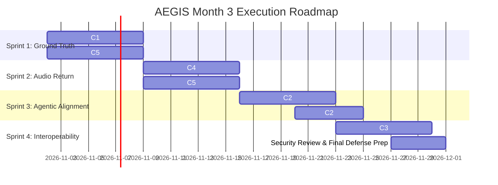

# AEGIS Month 3 AI & Systems Architecture Planning Document

**Author:** AEGIS AI & Forensic Architecture Team (Lead: Mohand Mohsen)  
**Status:** 📝 Draft for Team Review (Month 2 — Task 5 Deliverable)  
**Audience:** Entire AEGIS Team (AI, Cybersecurity, Web / UX Tracks), Dr. Amr Megahed, Eng. Ramez Yousri  
**Feeds:** Month 2 Milestone Review & Task 6 Walkthrough (`docs/month2_ai_track_summary.md`)  
**Cross-References:** `docs/LIMITATIONS.md` (Section 8: M2-L1 to M2-L15), `eval/reports/month2_vs_month1_full_benchmark_report.md`  
**Date:** October 27, 2026  

---

## 1. Executive Context: Where Month 2 Leaves AEGIS

Month 2 transitioned AEGIS from isolated heuristic components into an interconnected, multi-modal verification platform. The file-based pipeline now arbitrates conflicting detector evidence via a 3-round Judge Agent (`debate/judge_agent.py`), while the live surveillance pipeline fuses physical sensor noise (PRNU), cryptographic hash chains, and edge neural inference (MobileNetV3 INT8) into structured incident alerts (`live_pipeline/live_pipeline.py`).

However, rigorous code and empirical benchmarking revealed critical operational gaps:
1. **The Safety vs. Coverage Trade-Off:** The Judge Agent achieved 0 catastrophic false-authentics on contested cases, but at the cost of a **65.0% abstention rate** (`INTEGRITY_UNKNOWN`), while misclassifying one authentic case as high-severity synthetic (`P1_CRITICAL`) [M2-L11](file:///d:/Grad%20Projectt%20eccuuuuu/docs/LIMITATIONS.md#m2-l11-high-abstention-rate-65-integrity_unknown-and-single-sample-false-synthetic-p1-failure).
2. **Evaluation Provenance Gaps:** The Month 2 benchmark evaluated the Judge against fixtures derived from Month 1 runs when the video-classifier was evaluating random weights [M2-L12](file:///d:/Grad%20Projectt%20eccuuuuu/docs/LIMITATIONS.md#m2-l12-historical-fixture-provenance-poisoning-random-weight-checkpoints), while the live surveillance benchmark relied on synthetic flag injection rather than physical sensor extraction [M2-L13](file:///d:/Grad%20Projectt%20eccuuuuu/docs/LIMITATIONS.md#m2-l13-benchmark-circularity--missing-ground-truth-stream-fixtures).
3. **Planning Latency Breakdown:** Real-world cloud LLM planning latency (21.8s–365.5s) exceeds the ≤3.0s SLA by up to 120× [M2-L14](file:///d:/Grad%20Projectt%20eccuuuuu/docs/LIMITATIONS.md#m2-l14-unresolved-llm-planning-latency-sla-breakdown), forcing evaluation to rely on deterministic mocks.
4. **Modality & Signal Drops in Production:** Audio detection (AASIST) is silently filtered out before Judge arbitration [M2-L9](file:///d:/Grad%20Projectt%20eccuuuuu/docs/LIMITATIONS.md#m2-l9-complete-audio-modality-suppression-aasist-dropped-from-adjudication), environmental operating conditions are hardcoded [M2-L10](file:///d:/Grad%20Projectt%20eccuuuuu/docs/LIMITATIONS.md#m2-l10-static-environmental-operating-conditions-bypass-precedence-matrix), and streaming rPPG remains disconnected from the live pipeline [M2-L5](file:///d:/Grad%20Projectt%20eccuuuuu/docs/LIMITATIONS.md#m2-l5-modality-disconnect--streaming-rppg-omitted-from-live-pipeline).
5. **Emergence of Score-Inversion & Edge Traps:** The streaming rPPG core reintroduces the score-inversion trap where flat or still facial ROIs emit 100% synthetic scores [M2-L1](file:///d:/Grad%20Projectt%20eccuuuuu/docs/LIMITATIONS.md#m2-l1-score-inversion-trap-on-flat-signal), and fusion alerts fall back to empty-string hashes [M2-L7](file:///d:/Grad%20Projectt%20eccuuuuu/docs/LIMITATIONS.md#m2-l7-synthetic--placeholder-evidentiary-fallbacks-in-incident-alerts).

Month 3 must address these grounded findings rather than building speculative abstractions on unverified baselines.

---

## 2. Candidate Priorities for Month 3

### Candidate C1: Evaluation Integrity & Authentic Benchmarks (Foundational)
* **Motivation:** [M2-L12](file:///d:/Grad%20Projectt%20eccuuuuu/docs/LIMITATIONS.md#m2-l12-historical-fixture-provenance-poisoning-random-weight-checkpoints), [M2-L13](file:///d:/Grad%20Projectt%20eccuuuuu/docs/LIMITATIONS.md#m2-l13-benchmark-circularity--missing-ground-truth-stream-fixtures), [M2-L14](file:///d:/Grad%20Projectt%20eccuuuuu/docs/LIMITATIONS.md#m2-l14-unresolved-llm-planning-latency-sla-breakdown), [M2-L15](file:///d:/Grad%20Projectt%20eccuuuuu/docs/LIMITATIONS.md#m2-l15-disconnected-load-testing-transport-throughput-vs-model-inference). System research questions (RQ1 & RQ2) cannot be defended academically if evaluation cases rely on random weights, injected flags, or synthetic latency mocks.
* **Proposed Scope:**
  - Regenerate all 20 Month 1 audit fixtures using the refined, weight-loaded EfficientNet-B0 detector (`eval/reports/video_classifier_refinement.md`).
  - Commit reproducible live surveillance video fixtures (`security/fixtures/tampered_streams/`) with verifiable frame splices, replayed segments, and PRNU sensor mismatches.
  - Execute end-to-end multi-feed load tests with active neural model execution (SlidingWindowDetector INT8) running alongside mTLS socket ingestion.
* **Deliverables:**
  - `eval/fixtures/judge/month1_judge_cases_v2.json` (unpoisoned fixture dataset).
  - Committed stream test vectors in `security/fixtures/tampered_streams/`.
  - Re-run benchmark script `eval/scripts/benchmark_month2_vs_month1.py` with 100% unmocked ground truth.
* **Measurable Success Criteria:**
  - 100% of benchmark fixtures traced to genuine model weights (0% random-weight legacy samples).
  - Reproducible surveillance benchmark execution on a clean repository clone with 0 skipped scenarios.
  - Multi-feed load test reports sustainable concurrency with >= 8 active camera feeds under true neural inference with FPS retention >= 85.0%.
* **Effort:** Medium (M)
* **Risks:** Unpoisoned detector outputs will alter the dispute distribution, potentially shifting observed accuracy.
* **Owner Track(s):** AI Track (Lead) with Cybersecurity Support.

---

### Candidate C2: Alignment, Specification Gaming & Debate Calibration Study
* **Motivation:** [M2-L11](file:///d:/Grad%20Projectt%20eccuuuuu/docs/LIMITATIONS.md#m2-l11-high-abstention-rate-65-integrity_unknown-and-single-sample-false-synthetic-p1-failure). In Month 2, the Judge Agent achieved a target metric (0 false-authentics) by maximizing abstention (65.0% `INTEGRITY_UNKNOWN`), while the scoring pipeline rewarded this by treating non-false-authentics as `CORRECT`. This represents a textbook case of **specification gaming** in autonomous verification agents.
* **Proposed Scope:**
  - Conduct formal specification-gaming analysis: formulate multi-objective loss balancing False-Authentic Penalty ($C_{FA}$), False-Alarm Penalty ($C_{FP}$), and Abstention Cost ($C_{UNK}$).
  - Implement dynamic corroboration weighting: refine Guard 1 and Guard 2 in `debate/judge_agent.py` to allow high-confidence detector consensus to resolve minor cross-modal noise without defaulting to `INTEGRITY_UNKNOWN`.
  - Perform ablation study comparing static rule consensus, deterministic precedence matrix, and agentic LLM cross-examination.
* **Deliverables:**
  - Formal study document: `docs/alignment_specification_gaming_study.md`.
  - Tuned arbitration engine in `debate/judge_agent.py` reducing abstention.
  - Automated ablation test suite `debate/tests/test_debate_ablations.py`.
* **Measurable Success Criteria:**
  - Reduce `INTEGRITY_UNKNOWN` rate on contested benchmarks from 65.0% to <= 35.0% without allowing any catastrophic false-authentics (maintaining 0.0% false-authentic rate).
  - Eliminate the false-synthetic misclassification on sample `067.mp4`, maintaining >= 90.0% precision on decisive verdicts.
* **Effort:** Large (L)
* **Risks:** Narrowing the abstention threshold risks introducing false-authentics if weak corroboration is accepted.
* **Owner Track(s):** AI Track.

---

### Candidate C3: Model Context Protocol (MCP) Server Integration
* **Motivation:** Architectural roadmap commitment and threat model requirement (`THREAT_MODEL_full.md` L68, `mcp/README.md`). Currently `mcp/` is an empty stub. External agentic clients and SIEM orchestration cannot invoke AEGIS reasoning tools in a standardized protocol.
* **Proposed Scope:**
  - Implement full MCP server in `mcp/server.py` exposing AEGIS tools: `aegis_inspect_metadata`, `aegis_plan_verification`, `aegis_arbitrate_claims`, and `aegis_generate_court_report`.
  - Integrate prompt injection defenses and strict schema validation recommended in the Security Review (`docs/security_review_orchestrator_debate_layer.md` §4).
  - Add client integration examples for Claude Desktop / external agent workflows.
* **Deliverables:**
  - `mcp/server.py` and `mcp/tools/*.py` implementing the official MCP Python SDK.
  - Docker containerization: `Dockerfile.mcp` wired into `docker-compose.yml`.
  - Security unit tests in `mcp/tests/test_mcp_security.py` validating input sanitization.
* **Measurable Success Criteria:**
  - 100% of core forensic actions exposed via standardized MCP tool schemas.
  - 0 unhandled prompt injection or schema bypass vulnerabilities under automated security fuzzing.
  - Sub-50ms tool discovery and invocation overhead.
* **Effort:** Medium (M)
* **Risks:** Exposing agentic tools to external callers introduces indirect prompt injection vectors.
* **Owner Track(s):** AI Track (Joint with Dev / Orchestration).

---

### Candidate C4: Return to Audio Modality & Full-Spectrum Multi-Modal Debate
* **Motivation:** [M2-L9](file:///d:/Grad%20Projectt%20eccuuuuu/docs/LIMITATIONS.md#m2-l9-complete-audio-modality-suppression-aasist-dropped-from-adjudication), LIMITATIONS §7. Audio spoofing detection (AASIST) is currently isolated: the Judge Agent bridge actively drops AASIST before arbitration. Additionally, AASIST lacks Voice Activity Detection (VAD) and runtime `insufficient_signal` guardrails.
* **Proposed Scope:**
  - Author dedicated AASIST claim adapter in `debate/claim_wrapper.py` (`_adapt_aasist`).
  - Update `orchestrator/app/judge_bridge.py` to register `aasist` in `DEBATE_KNOWN_DETECTORS`.
  - Expand the Forensic Precedence Matrix with cross-modal AV rules (e.g., SyncNet conflicting with AASIST on silent or dubbed audio).
  - Add Silero VAD pre-filtering in `detectors/aasist/` to eliminate false alarms on non-speech acoustic segments.
* **Deliverables:**
  - Audio debate adapter in `debate/claim_wrapper.py`.
  - Precedence Matrix extensions in `debate/judge_agent.py`.
  - VAD preprocessor integration in `detectors/aasist/preprocess.py`.
  - Comprehensive multi-modal test suite in `debate/tests/test_audio_visual_debate.py`.
* **Measurable Success Criteria:**
  - AASIST claim integration verified with 100% pass rate across synthetic voice test fixtures.
  - 0 audio claims dropped by orchestrator `judge_bridge.py`.
  - False-positive rate on non-speech audio samples reduced by >= 80.0% via VAD pre-filtering.
* **Effort:** Medium (M)
* **Risks:** Multi-modal contradiction space expands from 3 to 4 detectors, increasing debate complexity.
* **Owner Track(s):** AI Track.

---

### Candidate C5: Production Pipeline Hardening & Dynamic Metadata Binding
* **Motivation:** [M2-L1](file:///d:/Grad%20Projectt%20eccuuuuu/docs/LIMITATIONS.md#m2-l1-score-inversion-trap-on-flat-signal), [M2-L3](file:///d:/Grad%20Projectt%20eccuuuuu/docs/LIMITATIONS.md#m2-l3-unvalidated-roi--full-frame-background-sampling), [M2-L5](file:///d:/Grad%20Projectt%20eccuuuuu/docs/LIMITATIONS.md#m2-l5-modality-disconnect--streaming-rppg-omitted-from-live-pipeline), [M2-L6](file:///d:/Grad%20Projectt%20eccuuuuu/docs/LIMITATIONS.md#m2-l6-mathematical-degeneracy-of-equal-weighted-fusion-verdicts), [M2-L7](file:///d:/Grad%20Projectt%20eccuuuuu/docs/LIMITATIONS.md#m2-l7-synthetic--placeholder-evidentiary-fallbacks-in-incident-alerts), [M2-L8](file:///d:/Grad%20Projectt%20eccuuuuu/docs/LIMITATIONS.md#m2-l8-temporal-anomaly-boundary-misattribution-across-sliding-windows), [M2-L10](file:///d:/Grad%20Projectt%20eccuuuuu/docs/LIMITATIONS.md#m2-l10-static-environmental-operating-conditions-bypass-precedence-matrix). Several operational bugs in the integration layer undermine reliable production deployments.
* **Proposed Scope:**
  - Fix streaming rPPG score-inversion: map flat or motionless signals to `status: insufficient_signal` rather than `score = 1.000`.
  - Connect detector runtime metrics (face presence, skin ratio, mean luminance) to `InputMetadata` so `judge_bridge.py` dynamically derives `OperatingConditions`.
  - Fix feed fusion alert generation: eliminate placeholder dummy camera IP and empty-string SHA-256 hashes.
  - Wire `StreamingRPPG` into `live_pipeline/live_pipeline.py` alongside MobileNetV3.
  - Calibrate fusion weights to eliminate the dead-zone where `ai_score in (0.35, 0.65)` trivially defaults to `UNCERTAIN`.
* **Deliverables:**
  - Patches in `detectors/rppg/streaming/streaming.py`, `orchestrator/app/judge_bridge.py`, and `security/fusion/feed_fusion.py`.
  - Fused multi-modal live pipeline in `live_pipeline/live_pipeline.py`.
  - Updated characterization tests in `detectors/rppg/tests/` and `security/fusion/tests/`.
* **Measurable Success Criteria:**
  - 0 score-inversion false-synthetics on motionless facial fixtures.
  - OperatingConditions dynamically populated with measured luminance and face detection ratios on 100% of file uploads.
  - 100% of SIEM alerts carry verified hardware certificates and non-empty forensic frame hashes.
* **Effort:** Large (L)
* **Risks:** Tight coupling across detector containers and orchestrator metadata schema.
* **Owner Track(s):** Joint AI & Cybersecurity Tracks.

---

## 3. Prioritisation Matrix & Recommended Sequencing

| Candidate | Theme | RQ1 / RQ2 Impact | Effort | Dependency Risk | Recommended Priority |
| :--- | :--- | :---: | :---: | :---: | :---: |
| **C1** | Evaluation Integrity & Authentic Benchmarks | **Critical** (validates both RQs) | Medium | Foundation for C2–C5 | **Priority 1 (Sprint 1)** |
| **C5** | Production Pipeline Hardening & Dynamic Binding | **High** (fixes operational flaws) | Large | Low | **Priority 2 (Sprint 1–2)** |
| **C4** | Return to Audio Modality & Debate Adapter | **High** (completes multimodal scope) | Medium | Depends on C1 | **Priority 3 (Sprint 2)** |
| **C2** | Alignment, Spec-Gaming & Calibration Study | **High** (core research contribution) | Large | Depends on C1, C4 | **Priority 4 (Sprint 3)** |
| **C3** | Model Context Protocol (MCP) Integration | **Medium** (interoperability & tooling) | Medium | Independent | **Priority 5 (Sprint 4)** |

### Recommended Sequencing Rationale
1. **Sprint 1 (Foundations & Ground Truth):** Execute **C1** (unpoisoned fixtures and real load testing) and core fixes of **C5** (score inversion and dynamic operating conditions). Until ground truth is authentic, further metric optimization is counterproductive.
2. **Sprint 2 (Multimodal Completeness):** Implement **C4** (AASIST audio debate adapter and VAD filtering). Reconnect the full multi-modal suite before tuning arbitration logic.
3. **Sprint 3 (Agentic Research & Alignment):** Execute **C2** (specification gaming study and consensus threshold tuning), answering the project's primary academic research questions on the unpoisoned multi-modal dataset.
4. **Sprint 4 (Interoperability & Polish):** Build **C3** (MCP server), hardening external tool-calling boundaries and finalizing documentation for the graduation project defense.

---

## 4. Proposed Week-by-Week Month 3 Roadmap

### Detailed Sprint Breakdown
* **Week 1 (Sprint 1): Evaluation Integrity & Bug Fixes**
  - AI Track: Re-run video-classifier on Month 1 audit set; regenerate clean judge fixtures (`C1`). Patch streaming rPPG score-inversion (`C5`).
  - Cyber Track: Commit authentic tampered stream video vectors; update multi-feed load test harness with edge model execution (`C1`).
  - Dev Track: Update `judge_bridge.py` to accept dynamic luminance/face metadata from preprocessors (`C5`).
* **Week 2 (Sprint 2): Audio Reintegration & Live Streaming Expansion**
  - AI Track: Build AASIST claim adapter in `debate/claim_wrapper.py`; wire Silero VAD into audio ingestion (`C4`).
  - Cyber / AI Joint: Wire `StreamingRPPG` into `live_pipeline/live_pipeline.py`; tune fusion thresholds to eliminate UNCERTAIN dead-zone (`C5`).
* **Week 3 (Sprint 3): Specification Gaming & Debate Calibration**
  - AI Track: Execute specification gaming study; calibrate consensus thresholds in `judge_agent.py` to reduce abstention below 35% (`C2`).
  - Whole Team: Full multi-modal ablation evaluation on unpoisoned fixtures (`C2`).
* **Week 4 (Sprint 4): MCP Integration & Graduation Defense Packaging**
  - AI / Dev Joint: Implement MCP server with `judge_file` and planner tools; apply security review sanitization filters (`C3`).
  - Whole Team: Freeze codebase, compile final graduation project documentation, and rehearse demonstration walkthroughs.

---

## 5. Architectural Decisions Needed from the Team

The following architectural questions must be discussed and resolved during the Month 2 Milestone Review:

1. **Abstention Policy & SOC Workflow:** Is a **65.0% `INTEGRITY_UNKNOWN` rate** operationally acceptable to Cybersecurity and SOC personnel, or does it risk critical alert fatigue? If we narrow the abstention band to force decisive verdicts, what false-alarm vs. false-negative cost ratio should guide arbitration?
2. **Planner Latency Strategy (Local vs. Dedicated Cloud):** Shared free-tier cloud models cannot achieve the ≤3.0s latency SLA (measured P95 > 200s). Does the team fund a dedicated cloud LLM endpoint (e.g., Groq / OpenRouter paid SLA), or do we commit to hosting a quantized local model (Llama-3-8B-Instruct INT4 via vLLM) on local GPU hardware?
3. **Live Surveillance AI Scope:** Should `StreamingRPPG` be mandated for the live surveillance pipeline in production, or should live surveillance deliberately remain restricted to spatial MobileNetV3 INT8 to protect multi-feed frame throughput?
4. **Tool-Calling Exposure via MCP:** Should external MCP clients be permitted to trigger raw detector microservices directly, or should the MCP server strictly expose the top-level `judge_file` and `plan_detectors` endpoints?

---

## 6. Non-Goals for Month 3

To ensure delivery of core academic and operational commitments, the following items are explicitly declared out of scope for Month 3:
* **Training New Detector Backbones from Scratch:** Model architectures (EfficientNet-B0, MobileNetV3, AASIST, SyncNet) will be fine-tuned or re-calibrated, but no novel foundation models will be trained.
* **Hardware-Specific ASIC / FPGA Acceleration:** Edge execution targets standard x86 / ARM CPU and consumer Nvidia GPUs (CUDA/TensorRT); custom FPGA bitstreams are out of scope.
* **Decentralized Blockchain Ledgers:** Forensic audit logs will use append-only SQLite with SHA-256 hash chains (ISO/IEC 27037 compliant); public blockchain anchoring is non-essential.
* **Full Multi-Camera Re-Identification:** Live surveillance focuses on single-camera stream integrity and deepfake detection, not cross-camera subject tracking across physical facilities.

---

*Authored by the AEGIS AI & Forensic Architecture Team. Circulated for team review prior to Month 2 Milestone Review.*
