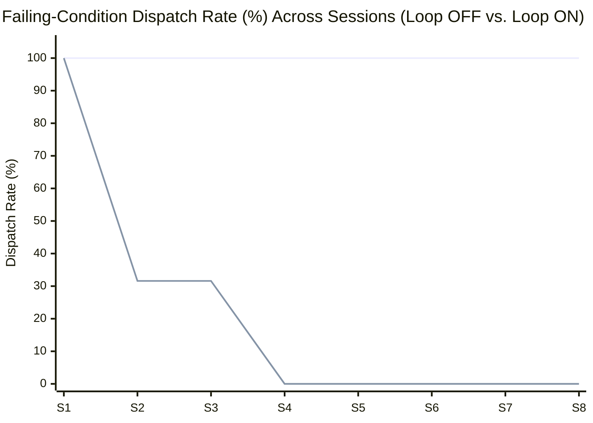
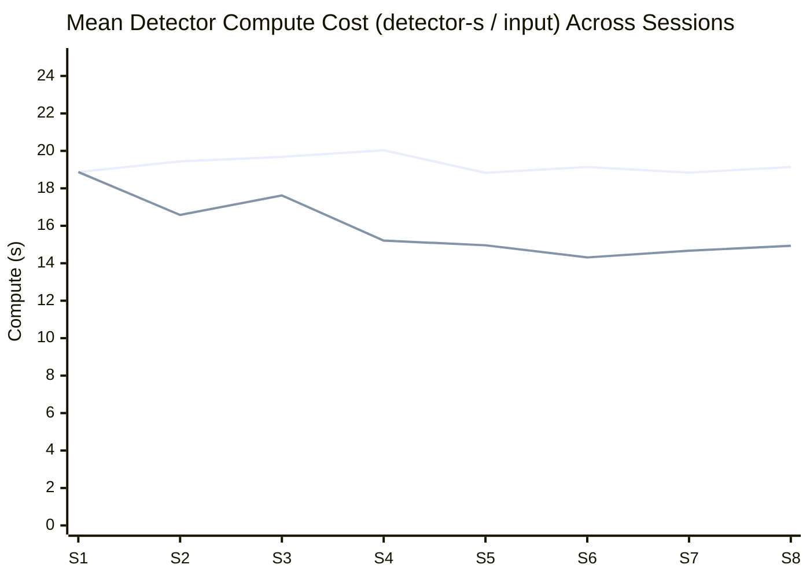

# AEGIS Task 5 (RQ2) — Closed-Loop Detector Reliability Feedback Evaluation

**Protocol:** 8 sequential sessions × 50 paired inputs/session (400 inputs per arm, deterministic seed `2026`).  
**Pipeline Executed:** `orchestrator/app/planner.py` → simulated condition-grounded detector outputs → `debate/judge_agent.py` (3-round arbitration) → `orchestrator/app/db.py` (`DetectorClaimOutcome`) → `orchestrator/app/reliability_feedback.py` (rolling-window manifest write-back).

---

## 1. Executive Comparison (Post-Adaptation Sessions 2–8, N=350 paired inputs)

| Metric | Loop OFF (Control) | Loop ON (Feedback) | Delta (ON − OFF) | Statistical Significance |
| :--- | ---: | ---: | ---: | :--- |
| **Failing-Condition Dispatch Rate** | 100.0% (95% CI [98.6%, 100.0%]) | **9.0%** (95% CI [6.1%, 13.1%]) | **-91.0 pp** | McNemar $b=242, c=0$, $p=0.00e+00$ |
| **Nominal Condition Retention Rate** | 100.0% | **100.0%** | +0.0 pp | Condition-specific preservation |
| **Confirmed-Wrong Overrules (S2–S8)** | 184 | **42** | **-142** (-20.29/session) | Paired $p=2.87e-06$ |
| **Total Confirmed-Wrong Claims** | 260 | **105** | **-155** | Fewer noisy claims sent to Judge |
| **Multi-Detector Conflict Rate** | 59.1% | **23.4%** | **-35.7 pp** | Paired $p=1.08e-05$ |
| **Verdict Accuracy** | 78.9% | **82.3%** | +3.4 pp | McNemar $b=2, c=14$, $p=0.0060$ |
| **Decisive Verdict Coverage** | 86.6% | **89.7%** | +3.1 pp | `AUTHENTIC` or `SYNTHETIC` |
| **False-Authentic / False-Synthetic** | 15 / 12 | **15 / 11** | +0 / -1 | Zero safety regression |
| **Mean Detector Compute (s / input)** | 19.30s | **15.47s** | **-3.83s** (-19.8%) | Paired $p=6.25e-05$ |
| **Mean Wall Latency (s / input)** | 8.78s | **8.62s** | **-0.16s** | Paired $p=1.00e-01$ |

---

## 2. Session-by-Session Learning Curve (Loop OFF vs. Loop ON)

| Session | Fail Dispatch OFF | Fail Dispatch ON | Nominal Retained ON | Confirmed Overrules (OFF → ON) | Conflict Rate (OFF → ON) | Compute s/input (OFF → ON) | Accuracy (OFF → ON) |
| :---: | ---: | ---: | ---: | :---: | :---: | :---: | :---: |
| S1 | 100.0% | 100.0% | 100.0% | 24 → 24 | 48.0% → 48.0% | 18.87s → 18.87s | 78.0% → 78.0% |
| S2 | 100.0% | 31.6% | 100.0% | 23 → 5 | 52.0% → 26.0% | 19.44s → 16.58s | 74.0% → 74.0% |
| S3 | 100.0% | 31.6% | 100.0% | 29 → 13 | 66.0% → 30.0% | 19.68s → 17.62s | 78.0% → 78.0% |
| S4 | 100.0% | 0.0% | 100.0% | 28 → 5 | 64.0% → 28.0% | 20.03s → 15.21s | 82.0% → 80.0% |
| S5 | 100.0% | 0.0% | 100.0% | 29 → 4 | 64.0% → 16.0% | 18.83s → 14.96s | 84.0% → 90.0% |
| S6 | 100.0% | 0.0% | 100.0% | 24 → 4 | 64.0% → 24.0% | 19.14s → 14.31s | 78.0% → 84.0% |
| S7 | 100.0% | 0.0% | 100.0% | 26 → 4 | 48.0% → 14.0% | 18.84s → 14.67s | 80.0% → 88.0% |
| S8 | 100.0% | 0.0% | 100.0% | 25 → 7 | 56.0% → 26.0% | 19.14s → 14.93s | 76.0% → 82.0% |

---

## 3. Per-Condition Rolling Reliability Trajectory (Loop ON)

| Session | `rppg` @ `low_light` | `rppg` @ `short_clip` | `syncnet` @ `dubbed_audio` | `rppg` @ `nominal` (Control) | `video-classifier` @ `low_light` |
| :---: | :---: | :---: | :---: | :---: | :---: |
| S1 | 0.296 (`deprioritize`) | 0.316 (`deprioritize`) | 0.688 (`caution`) | 0.688 (`caution`) | 0.815 (`reliable`) |
| S2 | 0.296 (`deprioritize`) | 0.316 (`deprioritize`) | 0.643 (`caution`) | 0.714 (`caution`) | 0.775 (`reliable`) |
| S3 | 0.296 (`deprioritize`) | 0.316 (`deprioritize`) | 0.525 (`deprioritize`) | 0.775 (`reliable`) | 0.792 (`reliable`) |
| S4 | 0.296 (`deprioritize`) | 0.316 (`deprioritize`) | 0.525 (`deprioritize`) | 0.731 (`reliable`) | 0.815 (`reliable`) |
| S5 | 0.296 (`deprioritize`) | 0.316 (`deprioritize`) | 0.525 (`deprioritize`) | 0.778 (`reliable`) | 0.870 (`reliable`) |
| S6 | 0.296 (`deprioritize`) | 0.316 (`deprioritize`) | 0.525 (`deprioritize`) | 0.778 (`reliable`) | 0.944 (`reliable`) |
| S7 | 0.296 (`deprioritize`) | 0.316 (`deprioritize`) | 0.525 (`deprioritize`) | 0.796 (`reliable`) | 0.907 (`reliable`) |
| S8 | 0.296 (`deprioritize`) | 0.316 (`deprioritize`) | 0.525 (`deprioritize`) | 0.833 (`reliable`) | 0.852 (`reliable`) |

---

## 4. Learning Curve Visualizations

