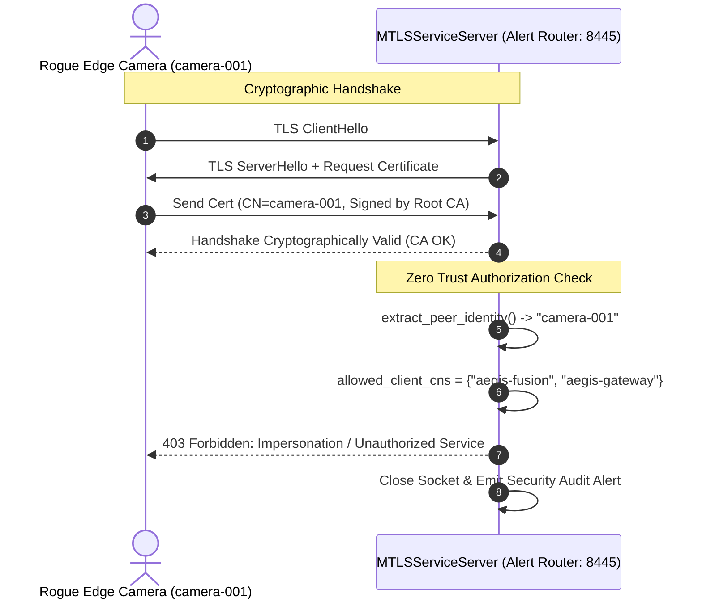

# 🛡️ AEGIS Zero Trust Inter-Service Transport Security Architecture (Task 6)
**Standard:** NIST SP 800-207 (Zero Trust Architecture) & RFC 8446 (TLS 1.3)  
**Status:** Implemented & Verified (Month 2 Milestone)  
**Modules:** [`security/transport/mtls_service_mesh.py`](file:///g:/College/Graduation%20Project/AEGIS-The-shield-against-synthetic-media/security/transport/mtls_service_mesh.py), [`security/transport/generate_certs.py`](file:///g:/College/Graduation%20Project/AEGIS-The-shield-against-synthetic-media/security/transport/generate_certs.py), [`security/incident_response/alert_router.py`](file:///g:/College/Graduation%20Project/AEGIS-The-shield-against-synthetic-media/security/incident_response/alert_router.py)

---

## 1. Executive Summary

AEGIS is a high-assurance anti-synthetic-media detection and forensic provenance pipeline. Week 1 established cryptographic device authentication (mTLS) strictly at the outer perimeter between physical edge camera sensors and the Ingestion Gateway. 

**Task 6** finalizes transport security by extending mutual TLS (mTLS) across **all inter-service boundaries** within the pipeline:
1. **Camera Edge Sensor $\to$ Ingestion Gateway** (Perimeter mTLS)
2. **Ingestion Gateway $\to$ Feed Fusion Module** (Inter-Service Mesh mTLS)
3. **Feed Fusion Module $\to$ Incident Alert Router** (Inter-Service Mesh mTLS)
4. **Incident Alert Router $\to$ Downstream SOC / SIEM Webhook** (Egress mTLS)

Under this Zero Trust model, no service implicitly trusts network locality, container boundaries, or IP addresses. Every connection requires mutual cryptographic authentication and strict application-layer peer role verification.

---

## 2. Public Key Infrastructure (PKI) Architecture

```
                          ┌────────────────────────┐
                          │     AEGIS Root CA      │
                          │  CN: aegis-root-ca     │
                          │   (Self-Signed 4096)   │
                          └───────────┬────────────┘
                                      │ Signs All Internal Certs
             ┌────────────────────────┼────────────────────────┐
             │                        │                        │
             ▼                        ▼                        ▼
    ┌─────────────────┐      ┌─────────────────┐      ┌─────────────────┐
    │  Gateway Cert   │      │   Fusion Cert   │      │ AlertRouter Cert│
    │ CN: aegis-gateway│      │ CN: aegis-fusion│      │CN:aegis-alert-rt│
    │SAN: DNS, Localhost│     │SAN: DNS, Localhost│     │SAN: DNS, Localhost│
    └─────────────────┘      └─────────────────┘      └─────────────────┘
             │                        │                        │
             ▼                        ▼                        ▼
    ┌─────────────────┐      ┌─────────────────┐
    │   Camera Cert   │      │    SIEM Cert    │
    │ CN: camera-001  │      │ CN: aegis-siem  │
    │SAN: Edge Sensor │      │SAN: SOC Webhook │
    └─────────────────┘      └─────────────────┘
```

### 2.1 X.509 Certificate Profile
All certificates issued by `generate_certs.py` adhere strictly to RFC 5280 and RFC 8446:
- **Signature Algorithm:** RSA-4096 / SHA-256 (or ECC secp256r1 for low-power edge sensors).
- **Extended Key Usage (EKU):** Dual purpose (`serverAuth`, `clientAuth`) to allow services to act bidirectionally as both mTLS servers and upstream clients.
- **Subject Alternative Names (SAN):** Explicitly generated for all service endpoints (e.g. `localhost`, `127.0.0.1`, `gateway.aegis.internal`, `fusion.aegis.internal`, `alertrouter.aegis.internal`) to prevent RFC 6125 hostname mismatches and deprecation warnings.
- **Key Validity:** 365 days with automated regeneration scripts.

---

## 3. Inter-Service Network & Port Topology

| Service Component | Role in Mesh | Ingress Port | Ingress Protocol | Egress Destination |
| :--- | :--- | :--- | :--- | :--- |
| **Edge Camera** | Client | N/A | N/A | Ingestion Gateway (TCP 8443) |
| **Ingestion Gateway** | Server + Client | TCP 8443 | mTLS 1.3 / 1.2 | Feed Fusion (TCP 8444) |
| **Feed Fusion** | Server + Client | TCP 8444 | mTLS 1.3 / 1.2 | Alert Router (TCP 8445) |
| **Alert Router** | Server + Client | TCP 8445 | mTLS 1.3 / 1.2 | Downstream SOC / SIEM (TCP 9443) |
| **Downstream SIEM/SOC**| Server | TCP 9443 | mTLS HTTPS | N/A |

---

## 4. Role-Based Identity & Peer Authorization (Zero Trust Enforcement)

A common vulnerability in traditional mTLS meshes is **lateral privilege escalation**: an attacker compromising a low-security edge camera credential can use that valid CA-signed certificate to speak to internal backend microservices.

AEGIS implements **Application-Layer Peer Identity Authorization** via `verify_peer_authorization()`:



### 4.1 Authorized Peer Matrix

| Destination Service | Listening Port | Authorized Client Common Names (CNs) | Unauthorized Callers (Rejected) |
| :--- | :--- | :--- | :--- |
| **Ingestion Gateway** | 8443 | `camera-001`, `camera-002`, `sensor-*` | Downstream internal services |
| **Feed Fusion** | 8444 | `aegis-gateway` | `camera-001`, `aegis-siem`, arbitrary clients |
| **Alert Router** | 8445 | `aegis-fusion`, `aegis-gateway` | `camera-001`, `aegis-siem`, untrusted CAs |
| **SOC / SIEM Webhook** | 9443 | `aegis-alert-router` | Ingestion Gateway, Edge cameras |

---

## 5. Developer Convenience & Production Hardening

In alignment with project guidelines, the transport security implementation supports dual operation modes:

1. **Development Mode:**
   - Standard local self-signed CA generation via `python security/transport/generate_certs.py`.
   - Local IP/hostname SANs pre-configured (`127.0.0.1`, `localhost`) so developers can run components on local workstations without DNS/hosts hacks.
   - Graceful fallback: If mutual client certificate verification is disabled during unit testing (`require_client_cert=False`), services log a warning rather than refusing to compile.
2. **Production Mode:**
   - Mandatory client authentication (`ssl.CERT_REQUIRED`).
   - Hostname and SAN verification strictly enforced (`check_hostname=True`).
   - Certificates loaded from secure secrets vaults or read-only volume mounts (`/etc/aegis/certs/`).
   - Immediate connection termination upon role authorization failure.

---

## 6. Verification and Test Matrix

The implementation is verified via the automated test suite in [`security/tests/test_inter_service_mtls.py`](file:///g:/College/Graduation%20Project/AEGIS-The-shield-against-synthetic-media/security/tests/test_inter_service_mtls.py):

| Test ID | Test Name | Target Boundary | Description | Result |
| :--- | :--- | :--- | :--- | :--- |
| **TC-MTLS-01** | `test_01_all_service_certificates_exist_and_have_sans` | PKI Infrastructure | Verifies 6 service certificates exist, are signed by Root CA, and contain valid SAN extensions. | **PASSED** |
| **TC-MTLS-02** | `test_02_gateway_to_fusion_mtls_rpc` | Gateway $\to$ Fusion | Verifies full encrypted mTLS RPC exchange with mutual certificate validation. | **PASSED** |
| **TC-MTLS-03** | `test_03_fusion_to_alert_router_mtls_rpc` | Fusion $\to$ Alert Router | Verifies mTLS RPC dispatch of high-priority synthetic media alerts. | **PASSED** |
| **TC-MTLS-04** | `test_04_cross_role_impersonation_rejection` | Camera $\to$ Alert Router | Confirms that a valid camera certificate attempting direct RPC to the Alert Router is rejected with 403. | **PASSED** |
| **TC-MTLS-05** | `test_05_rogue_untrusted_ca_rejection` | Rogue CA $\to$ Mesh | Confirms that certificates signed by a foreign/untrusted CA are rejected at the TLS handshake level. | **PASSED** |
| **TC-MTLS-06** | `test_06_mtls_alert_destination_e2e` | Router $\to$ MTLS Socket | Verifies end-to-end incident delivery from `AlertRouter` over `MTLSAlertDestination`. | **PASSED** |
| **TC-MTLS-07** | `test_07_webhook_destination_mtls_config` | Router $\to$ HTTPS SIEM | Verifies that `WebhookAlertDestination` properly binds client cert, key, and CA bundle for HTTPS mTLS. | **PASSED** |

In addition, regression testing against the entire security suite ([`run_prod_pentest.py`](file:///g:/College/Graduation%20Project/AEGIS-The-shield-against-synthetic-media/security/tests/run_prod_pentest.py), [`test_alert_routing.py`](file:///g:/College/Graduation%20Project/AEGIS-The-shield-against-synthetic-media/security/tests/test_alert_routing.py), [`test_evidence_vault.py`](file:///g:/College/Graduation%20Project/AEGIS-The-shield-against-synthetic-media/security/tests/test_evidence_vault.py)) confirms 34/34 tests passing with zero regressions.
