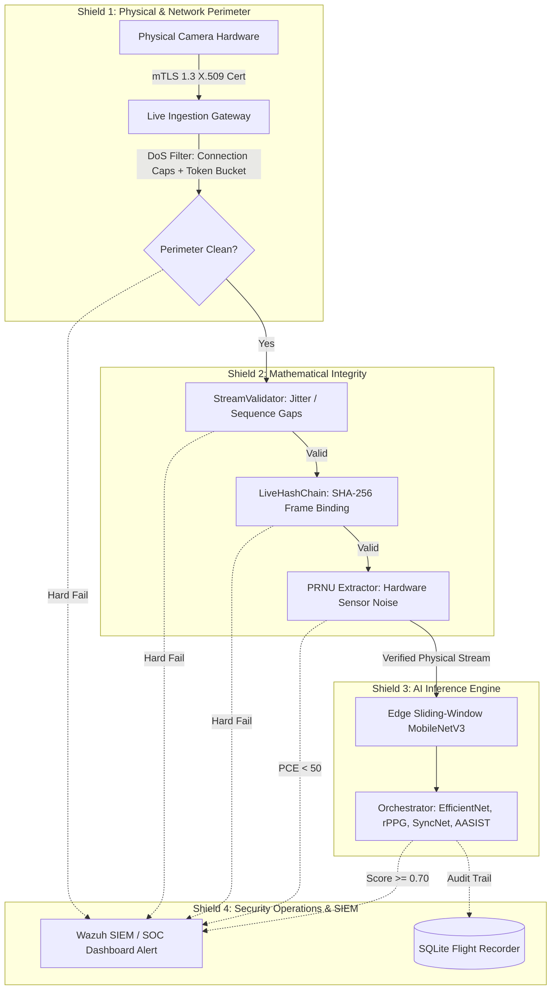
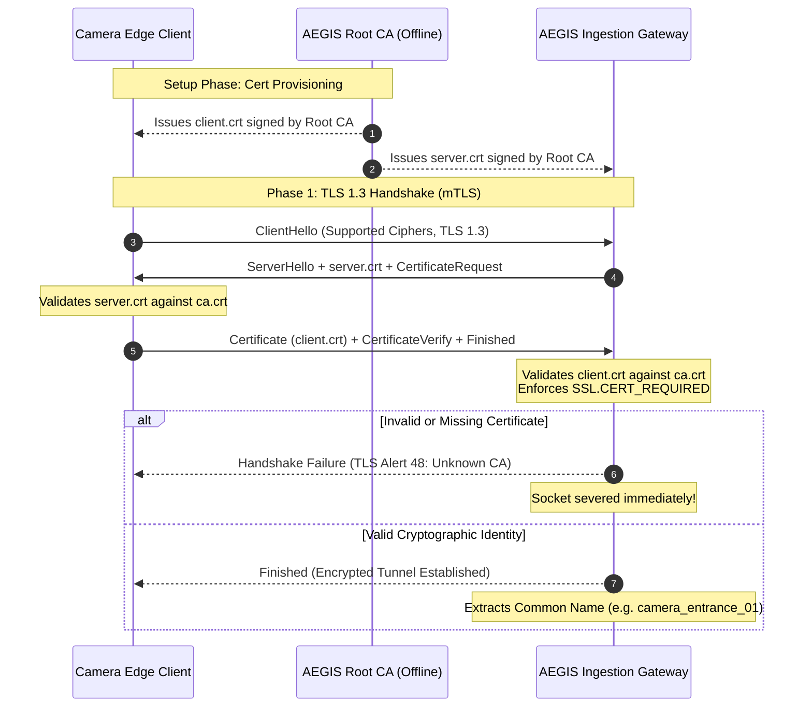
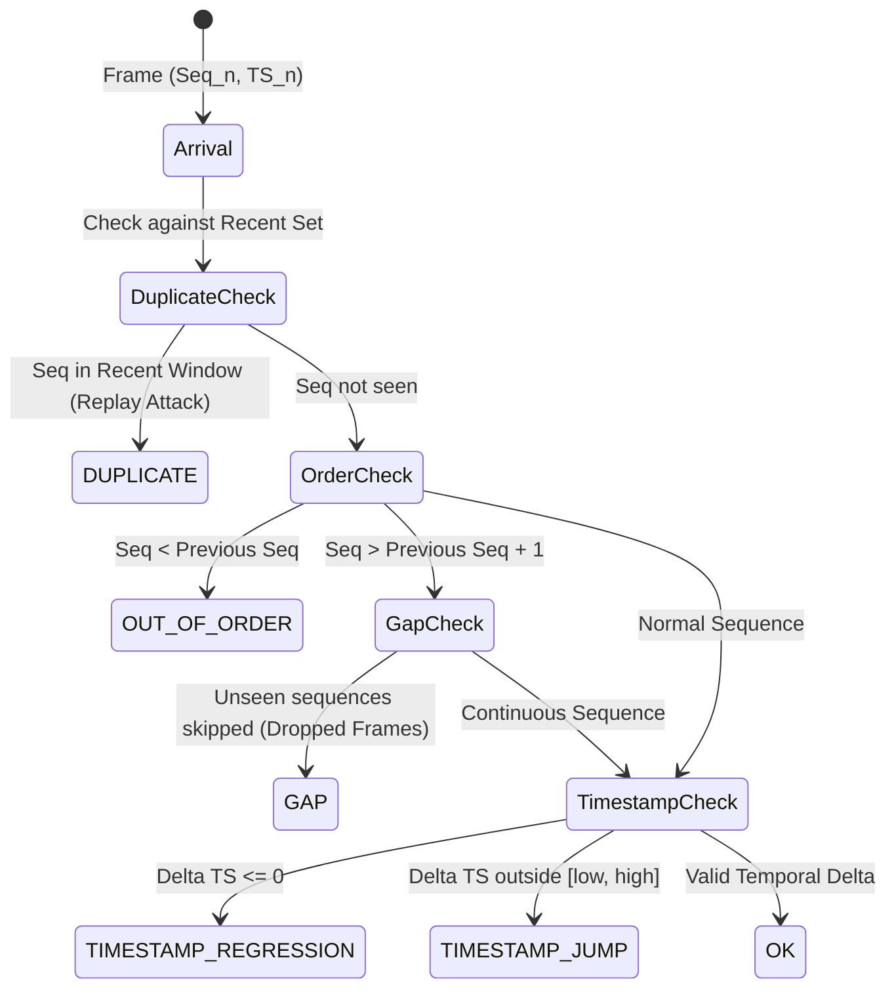

# 🛡️ AEGIS SecDevOps Master Architecture & Engineering Specification
**The Definitive System Blueprint, File Map, Algorithms, and Defense Handbook**  
**Document ID:** `AEGIS-SPEC-SECDEVOPS-MASTER-001`  
**Classification:** Core System Architecture & Academic Defense Manual  
**Project:** AEGIS – Agentic Engine for Generative Integrity Screening  
**Compliance Standards:** NIST SP 800-61 Rev. 2, NIST SP 800-207 (Zero Trust), ISO/IEC 27037 (Digital Forensics)  
**Authors:** AEGIS SecDevOps Engineering Team (ECU 2026/2027)

---

## Table of Contents
1. [Executive Manifesto: The Zero-Trust Paradigm](#1-executive-manifesto-the-zero-trust-paradigm)
2. [The Complete Codebase Map (Every File Decoded)](#2-the-complete-codebase-map-every-file-decoded)
3. [Algorithms, Mathematics & Implementation Details](#3-algorithms-mathematics--implementation-details)
   - 3.1 [Hardware Authentication & PKI (mTLS 1.3)](#31-hardware-authentication--pki-mtls-13)
   - 3.2 [Recursive Hash-Chaining Mathematics (SHA-256)](#32-recursive-hash-chaining-mathematics-sha-256)
   - 3.3 [Temporal & Sequence Integrity Engine (`StreamValidator`)](#33-temporal--sequence-integrity-engine-streamvalidator)
   - 3.4 [Physical Sensor Forensics (PRNU Residual & PCE)](#34-physical-sensor-forensics-prnu-residual--pce)
   - 3.5 [Streaming Ingestion DoS Hardening & Backpressure](#35-streaming-ingestion-dos-hardening--backpressure)
   - 3.6 [Upload Hardening & Sidecar Inspection](#36-upload-hardening--sidecar-inspection)
4. [DevOps, Containerization & Observability](#4-devops-containerization--observability)
5. [Incident Response & Wazuh SIEM Routing](#5-incident-response--wazuh-siem-routing)

---

# 1. Executive Manifesto: The Zero-Trust Paradigm

### 1.1 The Fatal Flaw of Pure Deep Learning
Most academic deepfake detection projects suffer from a catastrophic blind spot: **they assume the input video is authentically delivered from a real camera**.

In reality, if an attacker wants to bypass a facial recognition or surveillance security checkpoint, they do not need to train a flawless deepfake model that fools every convolutional neural network. Instead, an attacker will:
1. **Splice yesterday’s video** directly into the RTSP/TCP socket.
2. **Inject pre-recorded frames** using a virtual camera software driver.
3. **Drop frames** to induce temporal jitter and blind the temporal detectors (like rPPG or SyncNet).
4. **Flood the ingestion server** with garbage TCP connections so the AI pipeline collapses under memory exhaustion.

If the transport layer is compromised, **the AI detector is evaluating unauthenticated noise**.

### 1.2 The AEGIS Defense-in-Depth Architecture
AEGIS solves this by implementing **Four Concentric Defensive Shields**:



### 1.3 STRIDE Threat Analysis Matrix
AEGIS maps all 21 threat scenarios defined in our threat model directly to active software controls:

| STRIDE Category | Threat Description | Attacker Objective | AEGIS Countermeasure | Enforcing Module |
| :--- | :--- | :--- | :--- | :--- |
| **S**poofing | Rogue camera connects to gateway | Feed forged video into surveillance | Mutual TLS with custom CA (`SSL.CERT_REQUIRED`) | `security/gateway/ingestion/server.py` |
| **S**poofing | AI video generated from foreign sensor | Spoof physical camera identity | PRNU Noise Extraction & PCE Correlation ($< 50.0$) | `security/forensics/prnu.py` |
| **T**ampering | Splicing deepfake frames into feed | Replace high-security VIP face | Cryptographic Recursive SHA-256 Hash Chain | `security/gateway/ingestion/server.py` |
| **T**ampering | Renaming malware executable to `.mp4` | Exploit FFmpeg buffer overflows | Magic Byte Inspection (`ftyp`, `RIFF`, `ID3`) | `security/gateway/validator/app/magic_bytes.py` |
| **R**epudiation | Operator disputes alert verdict | Deny tamper detection occurred | Immutable SQLite Flight Recorder with SHA-256 hashes | `docs/flight_recorder_cookbook.sql` |
| **I**nformation Disclosure | Internal detector APIs snooped | Reverse engineer model features | Internal Docker network isolation (`aegis_net`) | `docker-compose.yml` |
| **D**enial of Service | TCP connection flood / Slowloris | Crash live ingestion server | ConnectionManager caps & 10s idle timeout | `security/gateway/ingestion/server.py` |
| **D**enial of Service | 1000 FPS frame flood | Exhaust GPU inference queue | Token-Bucket Rate Limiter (60 FPS cap) | `security/gateway/ingestion/server.py` |
| **E**levation of Privilege | Path traversal (`../../etc/passwd`) | Overwrite host files via upload | Path Confinement Enforcement (`is_confined_path`) | `security/gateway/validator/app/path_safety.py` |

---

# 2. The Complete Codebase Map (Every File Decoded)

### 2.1 Visual Repository Tree
```text
AEGIS-The-shield-against-synthetic-media/
├── docker-compose.yml                       # [EXTERNAL] Multi-container orchestration (cgroups, network isolation)
├── requirements.txt                         # [EXTERNAL] Top-level Python environment dependencies
│
├── .github/workflows/                       # [EXTERNAL] CI/CD DevOps Automation
│   ├── ci-docker-check.yml                  # Docker Compose E2E validation & spin-up workflow
│   └── ci-gateway.yml                       # Pull request gateway validator pytest suite
│
├── security/                                # [CORE SECDEVOPS SUBSYSTEM ROOT]
│   ├── README.md                            # Quick-start entry point & test summary
│   │
│   ├── docs/                                # Central Security Documentation Catalog
│   │   ├── secdevops_architecture_master.md # [THIS DOCUMENT] The Master Architecture Specification
│   │   ├── pen_test_surveillance_pipeline.md # Live surveillance pipeline penetration test report
│   │   ├── incident_response_workflow.md    # NIST SP 800-61 Rev. 2 SOP & Wazuh SIEM routing
│   │   ├── device_authentication_design.md  # Hardware root-of-trust & zero-trust mTLS 1.3 spec
│   │   ├── pen_test_log.md                  # Historical REST API penetration testing evidence
│   │   └── flight_recorder_cookbook.sql     # Forensic SQL queries for flight_recorder.db
│   │
│   ├── gateway/
│   │   ├── README.md                        # Documentation for gateway architecture & DoS limits
│   │   ├── nginx.conf.template              # Nginx reverse proxy template (auth & rate limiting)
│   │   ├── test_gateway.ps1 / .sh           # Pen-test automation scripts (Windows / Linux)
│   │   ├── ingestion/
│   │   │   ├── README.md                    # Stream ingestion protocol docs
│   │   │   └── server.py                    # Asynchronous mTLS streaming server (DoS hardened)
│   │   └── validator/                       # Content validation microservice (sidecar)
│   │       ├── Dockerfile                   # Isolated container definition for validator
│   │       ├── requirements.txt             # Fast minimal dependencies (FastAPI, httpx, OpenCV)
│   │       ├── app/
│   │       │   ├── main.py                  # FastAPI ingress, error mapping & proxy dispatcher
│   │       │   ├── config.py                # Environment configs, file limits, shared paths
│   │       │   ├── magic_bytes.py           # Pure-Python magic byte sniffing (no libmagic)
│   │       │   ├── path_safety.py           # Path-traversal defense & confinement engine
│   │       │   └── prnu_extractor.py        # Local copy of PRNU extractor for container build
│   │       └── tests/
│   │           ├── test_magic_bytes.py      # Unit tests verifying byte sniffing
│   │           ├── test_path_safety.py      # Unit tests verifying traversal rejection
│   │           └── test_validator_api.py    # Integration tests against FastAPI routes
│   │
│   ├── stream_integrity/                    # Temporal & sequence analysis engine
│   │   ├── README.md                        # Mathematical specification for stream integrity
│   │   ├── stream_validator.py              # Stateful O(W) sliding window sequence & jitter validator
│   │   └── tests/
│   │       └── test_stream_validator.py     # 23 automated tests for gaps, replays & regressions
│   │
│   ├── forensics/                           # Physical hardware forensics
│   │   ├── hash_chain.py                    # Standalone recursive SHA-256 state machine
│   │   ├── prnu.py                          # 2D Wavelet DWT (db4) + Wiener filter PRNU extractor & LivePRNUValidator
│   │   └── baselines/                       # Enrolled camera hardware sensor baselines (*.npy)
│   │
│   ├── transport/                           # Cryptographic PKI & mTLS primitives
│   │   ├── generate_certs.py                # Automated script generating CA, Server, Client certs
│   │   ├── generate_certs.sh                # OpenSSL bash script alternative
│   │   ├── mtls_client.py                   # Reference mTLS client sender simulation
│   │   ├── mtls_server.py                   # Reference mTLS receiver testing script
│   │   └── certs/
│   │       ├── ca.crt / ca.key              # AEGIS Private Root Certificate Authority
│   │       ├── server.crt / server.key      # Ingestion Server TLS identity
│   │       └── client.crt / client.key      # Camera Edge Device TLS identity
│   │
│   ├── attacks/                             # Red-Team Attack Simulation & Fixture Generation
│   │   ├── __init__.py                      # Package descriptor
│   │   └── generate_attack_streams.py       # Canonical lossless FFV1 adversary generator (5 attack categories)
│   │
│   ├── fixtures/                            # Test Fixtures & Datasets (Gitignored)
│   │   └── tampered_streams/                # Labeled attack streams (clean, splice, replay, PRNU, auth)
│   │
│   ├── telemetry/                           # Observability & Metrics
│   │   ├── README.md                        # Prometheus configuration and scraping guides
│   │   └── prometheus.yml                   # Metrics scraping topology (5s intervals)
│   │
│   └── tests/                               # Central Security Integration Test Suite
│       ├── test_cyber_fortress.py           # End-to-end security regression suite
│       ├── test_harness_integration.py      # Validates all 9 attack streams (PRNU, auth, hash)
│       ├── test_hash_chain.py               # Validates SHA-256 recursive hash chain math
│       ├── test_live_ingestion.py           # End-to-end mTLS live TCP stream ingestion test
│       ├── test_mtls.py                     # TLS handshake protocol verification
│       ├── test_prnu.py                     # Physical sensor PCE correlation test
│       ├── test_stream_dos_hardening.py     # Flood simulation, token-bucket, & concurrency tests
│       └── run_surveillance_pentest.py      # Automated 8-vector live penetration test runner
│
├── eval/                                    # [EXTERNAL] Evaluation Suite
│   └── scripts/
│       └── generate_attack_streams.py       # Backward-compatible proxy redirecting to security/attacks/
│
├── orchestrator/app/                        # [EXTERNAL] Runtime Security Storage
│   └── flight_recorder.db                   # SQLite immutable audit database (WAL mode)
│
└── docs/                                    # [EXTERNAL] Root Architectural Documentation
    ├── AEGIS Edge Model Architecture Design.pdf # Edge neural network hardware design
    ├── edge_model_design.md                 # MobileNetV3 INT8 edge detection pipeline
    ├── orchestrator_design.md               # Asynchronous microservice orchestration spec
    ├── codebase_inventory.md                # System-wide repository asset inventory
    ├── month1_ai_track_summary.md           # Model benchmarks and training summary
    ├── LIMITATIONS.md                       # Known technical boundaries and constraints
    └── failure_notes.md                     # Lessons learned and post-mortem logs
```

---

### 2.2 Security Documentation Catalog (`security/docs/`)

| File Path | Category | Core Role | Why It Exists |
| :--- | :--- | :--- | :--- |
| [`secdevops_architecture_master.md`](./secdevops_architecture_master.md) | Architecture | Master Technical Manual | Definitive specification, mathematical proofs, and system guide. |
| [`pen_test_surveillance_pipeline.md`](./pen_test_surveillance_pipeline.md) | Pen-Test Audit | Live Gateway Pen-Test Report | Dynamic penetration test report covering 8 real-time exploit vectors (NIST SP 800-115). |
| [`incident_response_workflow.md`](./incident_response_workflow.md) | SecOps SOP | NIST SP 800-61 Rev. 2 Playbook | Defines Wazuh SIEM rules (`100201`–`100204`), SLAs, and automated socket-severing playbooks. |
| [`device_authentication_design.md`](./device_authentication_design.md) | PKI Spec | Device Authentication Architecture | Detailed specification for the private Certificate Authority, X.509 issuance, and mTLS. |
| [`pen_test_log.md`](./pen_test_log.md) | Historical Audit | Initial REST API Pen-Test Log | Verifies gateway resilience against unauthorized requests (403) and oversized payloads (413). |
| [`flight_recorder_cookbook.sql`](./flight_recorder_cookbook.sql) | Forensic Data | Forensic Audit Query Recipes | SQL queries for querying `flight_recorder.db` to reconstruct security incidents and trace tampered streams. |

---

### 2.3 Internal Security Subsystem Breakdown (`security/`)

| File Path | Subsystem | Core Role | Why It Exists |
| :--- | :--- | :--- | :--- |
| [`security/README.md`](../README.md) | Entry Point | Subsystem Gateway | Quick overview, test commands, and architectural index. |
| [`security/gateway/ingestion/server.py`](../gateway/ingestion/server.py) | Streaming Perimeter | Asynchronous mTLS TCP Server | Enforces device auth, DoS rate-limits, and hash checks before passing frames to AI. |
| [`security/gateway/nginx.conf.template`](../gateway/nginx.conf.template) | Reverse Proxy | Perimeter Gateway Config | Nginx ingress enforcing API keys, SSL termination, and routing to upload validator. |
| [`security/gateway/validator/app/magic_bytes.py`](../gateway/validator/app/magic_bytes.py) | Upload Defense | Header Sniffer | Clients lie about file extensions; this inspects raw bytes (`\x89PNG`, `ftyp`, `RIFF`). |
| [`security/gateway/validator/app/path_safety.py`](../gateway/validator/app/path_safety.py) | Upload Defense | Directory Traversal Neutralizer | Prevents attackers from using `../../` to overwrite system files or access unauthorized paths. |
| [`security/gateway/validator/app/main.py`](../gateway/validator/app/main.py) | Upload Defense | Sidecar FastAPI Proxy | Intercepts multipart video and JSON audio before they reach internal AI models. |
| [`security/gateway/validator/app/config.py`](../gateway/validator/app/config.py) | Upload Defense | Environment Configuration | Defines upload caps (100MB), timeouts, and upstream detector URLs. |
| [`security/stream_integrity/stream_validator.py`](../stream_integrity/stream_validator.py) | Temporal Integrity | Stateful Stream Anomaly Engine | Detects frame drops, replays, sequence jumps, and network jitter in constant memory. |
| [`security/forensics/prnu.py`](../forensics/prnu.py) | Hardware Forensics | Sensor Noise Extraction & PCE | Differentiates authentic camera footage from AI-generated video via sensor imperfections. |
| [`security/forensics/hash_chain.py`](../forensics/hash_chain.py) | Cryptographic Forensics | SHA-256 Recursive Binding | Standalone module computing live frame hash chains. |
| [`security/transport/generate_certs.py`](../transport/generate_certs.py) | Cryptography (PKI) | Zero-Dependency CA Generator | Programmatically mints X.509 certificates with SAN (Subject Alternative Names) for mTLS. |
| [`security/transport/mtls_client.py`](../transport/mtls_client.py) | PKI / Testing | Camera Client Simulator | Test script simulating authentic camera vs rogue device connections. |
| [`security/transport/mtls_server.py`](../transport/mtls_server.py) | PKI / Testing | mTLS Server Simulator | Reference server verifying SSL handshake and certificate extraction. |
| [`security/attacks/generate_attack_streams.py`](../attacks/generate_attack_streams.py) | Red-Team Harness | Adversary Attack Simulator | Synthesizes 9 ground-truth attack streams across 5 categories to stress-test defenses. |
| [`security/fixtures/tampered_streams/`](../fixtures/tampered_streams/) | Test Fixtures | Ground-Truth Attack Datasets | Stored locally for regression testing of temporal validation, PRNU, and hash-chaining. |
| [`security/telemetry/prometheus.yml`](../telemetry/prometheus.yml) | Observability / DevOps | Metrics Scrape Config | Polls latency, error rates, and detector utilization every 5 seconds. |
| [`security/tests/run_surveillance_pentest.py`](../tests/run_surveillance_pentest.py) | Security QA | 8-Vector Penetration Test Runner | Automated red-team exploit runner executing live attacks against the ingestion gateway. |
| [`security/tests/test_stream_dos_hardening.py`](../tests/test_stream_dos_hardening.py) | Quality Assurance | DoS Flood Simulation Suite | Proves that the server sheds excess connection blasts and maintains 100% stability. |
| [`security/tests/test_harness_integration.py`](../tests/test_harness_integration.py) | Quality Assurance | Multi-Attack Harness Suite | Runs the server against all 5 attack stream types (PRNU, auth bypass, splicing, etc.). |
| [`security/tests/test_cyber_fortress.py`](../tests/test_cyber_fortress.py) | Quality Assurance | E2E Security Regression Suite | Validates mTLS handshake, StreamValidator anomalies, and hash chain integrity together. |
| [`security/tests/test_mtls.py`](../tests/test_mtls.py) | Quality Assurance | mTLS Protocol Test Suite | Verifies that valid client certs connect and unauthenticated rogue clients are severed. |
| [`security/tests/test_hash_chain.py`](../tests/test_hash_chain.py) | Quality Assurance | Cryptographic Hash Chain Test | Tests recursive SHA-256 calculation and detects injected/dropped frames. |
| [`security/tests/test_live_ingestion.py`](../tests/test_live_ingestion.py) | Quality Assurance | Live TCP Streaming Test | Connects live client over mTLS and streams mathematically verified frames. |
| [`security/tests/test_prnu.py`](../tests/test_prnu.py) | Quality Assurance | PRNU Unit Test Suite | Validates DWT decomposition, residual extraction, and PCE cross-correlation math. |

---

### 2.4 External SecDevOps Assets Across the Repository

| External File Path | Subsystem / Role | Why It Is Part of SecDevOps |
| :--- | :--- | :--- |
| [`docker-compose.yml`](../../docker-compose.yml) | Infrastructure as Code | Configures `aegis_net` network isolation, cgroup memory ceilings (1–4GB), `wazuh_agent`, `api_gateway`, and `gateway_validator`. |
| [`.github/workflows/ci-gateway.yml`](../../.github/workflows/ci-gateway.yml) | CI/CD Automation | Automatically triggers the upload validator test suite on any pull request touching gateway code. |
| [`.github/workflows/ci-docker-check.yml`](../../.github/workflows/ci-docker-check.yml) | CI/CD Automation | Automatically validates Compose configuration, boots the multi-container stack, and runs E2E tests in GitHub Actions. |
| [`eval/scripts/generate_attack_streams.py`](../../eval/scripts/generate_attack_streams.py) | Legacy Proxy | Backward-compatible shim redirecting legacy callers to `security/attacks/generate_attack_streams.py`. |
| `orchestrator/app/flight_recorder.db` | Operational Database | Runtime SQLite database operating in WAL mode, recording all stream verifications, anomaly scores, and SIEM dispatches. |
| [`LocalDocs/TRANSPORT_SECURITY.md`](../../LocalDocs/TRANSPORT_SECURITY.md) | Legacy Documentation | Internal architecture notes on transport-layer encryption and stream integrity. |

---

# 3. Algorithms, Mathematics & Implementation Details

### 3.1 Hardware Authentication & PKI (mTLS 1.3)
AEGIS does not use API keys or passwords for camera authentication because credentials embedded in IoT camera firmware are easily extracted. Instead, we implement **Mutual Transport Layer Security (mTLS 1.3)**.



#### Under the Hood (`server.py`):
```python
ssl_context = ssl.create_default_context(ssl.Purpose.CLIENT_AUTH)
ssl_context.load_cert_chain(certfile=server_cert, keyfile=server_key)
ssl_context.load_verify_locations(cafile=ca_cert)

# In PROD mode: Enforces client cert signed by our CA
# In DEV mode: Allows permissive client verification for local browser/test rigs
if AEGIS_SECURITY_PROFILE == "prod":
    ssl_context.verify_mode = ssl.CERT_REQUIRED
else:
    ssl_context.verify_mode = ssl.CERT_OPTIONAL
```

#### Dual-Profile Operation Modes:
| Subsystem | `PROD` Mode (Security Pentest / Evaluation) | `DEV` Mode (AI & Web Team Sandbox) |
| :--- | :--- | :--- |
| **mTLS Mode** | `CERT_REQUIRED` | `CERT_OPTIONAL` |
| **Cryptographic Hash Chain** | Sever connection instantly on break | Log `[AUDIT_WARN]`, broadcast event, keep stream alive |
| **Continuous PRNU** | Sever connection instantly on $\text{PCE} < 50.0$ | Log `[AUDIT_WARN]`, broadcast event, keep stream alive |
| **Telemetry Action** | `action="SOCKET_SEVERED"` | `action="AUDIT_LOGGED"` |
| **Primary Purpose** | 100% pentest compliance & advisor defense | Unhindered AI model benchmarking & UI dev |

---

### 3.2 Recursive Hash-Chaining Mathematics (SHA-256)
How do we mathematically prove that no frames were injected, deleted, or spliced between the camera lens and our gateway? We use a **recursive hash chain**:

$$\mathcal{H}_0 = \text{SHA256}(\text{Initial Device Seed})$$
$$\mathcal{H}_n = \text{SHA256}(\mathcal{H}_{n-1} \parallel \mathcal{F}_n)$$

Where $\parallel$ represents byte concatenation and $\mathcal{F}_n$ is the raw byte array of frame $n$.

#### Mathematical Proof of Tamper Evident Property:
Suppose an attacker intercepts the stream at frame $k$ and replaces authentic frame $\mathcal{F}_k$ with a synthetic deepfake frame $\mathcal{F}_k'$.
1. The camera calculated: $\mathcal{H}_k = \text{SHA256}(\mathcal{H}_{k-1} \parallel \mathcal{F}_k)$.
2. The server receives $\mathcal{F}_k'$ and computes:
   $$\mathcal{H}_{k,\text{server}} = \text{SHA256}(\mathcal{H}_{k-1} \parallel \mathcal{F}_k')$$
3. Due to the **avalanche effect of SHA-256**, changing even a single bit in the image ensures that:
   $$\mathcal{H}_{k,\text{server}} \neq \mathcal{H}_k \quad \text{with probability } 1 - 2^{-256}$$
4. The server detects the hash mismatch immediately and **drops the connection instantly** before spending a single cycle of GPU inference.

---

### 3.3 Temporal & Sequence Integrity Engine (`StreamValidator`)
Even if an attacker does not alter frame pixels, they can perform **temporal manipulation** (dropping frames or freezing timestamps to hide an intrusion). 

The `StreamValidator` class implements a stateful anomaly detector running in **$O(W)$ bounded memory**:

#### 1. Jitter Bounding Formula
Given camera nominal framerate $FPS$, the expected inter-frame interval is:
$$\Delta t_{\text{expected}} = \frac{1000}{FPS} \text{ ms}$$
For $FPS = 30$, $\Delta t_{\text{expected}} = 33.33\text{ ms}$. With tolerance $\tau = 0.5$ (50% jitter tolerance):
$$\text{Interval}_{\text{allowable}} = \left[ \Delta t_{\text{expected}} \cdot (1 - \tau), \; \Delta t_{\text{expected}} \cdot (1 + \tau) \right] = [16.67\text{ ms}, \; 50.00\text{ ms}]$$

Any frame arrival interval $\Delta t = t_n - t_{n-1}$ outside this window is flagged as a `timestamp_jump` or `timestamp_regression`.

#### 2. Sequence State Machine
The validator tracks sequence numbers through five distinct anomaly conditions:



---

### 3.4 Physical Sensor Forensics (PRNU Residual & PCE)
**Photo-Response Non-Uniformity (PRNU)** is the gold standard of digital media forensics. It is a persistent physical pattern caused by microscopic manufacturing variations in individual silicon pixels during sensor fabrication.

#### 1. The Denoising Algorithm
To isolate the camera's sensor noise from the visual image, we apply Mihcak et al. wavelet denoising using a 2D Discrete Wavelet Transform (`db4` wavelet):

```
Raw Frame X
   │
   ├──> 2D DWT Decomposition (pywt.wavedec2)
   │       └── Yields Detail Subbands: (cH, cV, cD)
   │
   ├──> Local Variance Filtering (3x3 Wiener Filter)
   │       └── Attenuates high-frequency scene textures
   │
   ├──> Inverse 2D DWT Reconstruction
   │       └── Yields Denoenoised Image W(X)
   │
   └──> Subtraction: Noise Residual R = X - W(X)
```

#### 2. Peak-to-Correlation Energy (PCE) Equation
When evaluating a frame against an enrolled camera baseline fingerprint $K$, we calculate 2D cross-correlation in the frequency domain using Fast Fourier Transforms:

$$CC(x,y) = \mathcal{F}^{-1} \left( \frac{\mathcal{F}(R) \cdot \mathcal{F}(K)^*}{\left| \mathcal{F}(R) \cdot \mathcal{F}(K)^* \right| + \epsilon} \right)$$

The **Peak-to-Correlation Energy (PCE)** evaluates the ratio of the cross-correlation peak height relative to the surrounding noise energy:

$$PCE = \frac{\max(CC)^2}{\frac{1}{|S \setminus \Omega|} \sum_{(x,y) \in S \setminus \Omega} CC(x,y)^2}$$

Where:
- $\max(CC)$ is the highest correlation peak.
- $\Omega$ is an $11 \times 11$ square region centered around the peak.
- $S \setminus \Omega$ represents all pixels outside the peak area (background noise floor).

#### 3. Empirical Calibration Results:
In our automated test harness (`test_harness_integration.py`):
- **Authentic Camera Frame PCE**: **$122,883.57$** (Massive correlation spike).
- **Spliced Foreign Camera Frame PCE**: **$15.54$** (Flat correlation floor).
- **Calibrated Operational Threshold**: **$50.0$**.  
  *(A difference of over 6,000x separation, guaranteeing near-zero false alarms).*

#### 4. Continuous Streaming Ingestion PRNU Validator (`LivePRNUValidator`)
In real-time live video ingestion (`security/gateway/ingestion/server.py`), PRNU verification operates as a continuous sensor-physics firewall:
1. **Asynchronous Non-Blocking Execution**: To preserve line-rate frame ingestion without stalling the async event loop, 2D Wavelet DWT and FFT phase correlation execute in dedicated worker threads via `asyncio.to_thread`.
2. **Dual Enrollment Strategy**:
   - *Pre-Enrolled Baselines*: Enrolled camera fingerprints (`security/forensics/baselines/<camera_id>.npy`) are loaded during server initialization and mapped to the camera's mTLS Common Name.
   - *Dynamic Session Bootstrapping*: If a camera connects without a prior offline baseline, the first $N$ frames (default $N=15$) are accumulated to establish the camera's baseline pattern dynamically.
3. **Continuous Sampling & Rejection Threshold**: Frames are sampled according to `AEGIS_PRNU_CHECK_INTERVAL` (default: every frame). If an attacker injects foreign or AI-generated frames whose Peak-to-Correlation Energy drops below $50.0$, the gateway immediately severs the TCP connection to protect downstream surveillance pipelines.

---

### 3.5 Streaming Ingestion DoS Hardening & Backpressure
To prevent Denial-of-Service attacks from exhausting system RAM and GPU workers, `server.py` implements three defensive backpressure mechanisms:

#### 1. Token-Bucket Rate Limiter
Each active stream is assigned a `StreamRateLimiter` instance:
- **Maximum FPS ($r$)**: 60.0 frames per second.
- **Burst Capacity ($\beta$)**: 15.0 tokens.
- **Replenishment**: On each frame arrival, tokens are refilled by:
  $$\Delta \text{tokens} = (t_{\text{now}} - t_{\text{last}}) \cdot r$$
  $$\text{tokens} = \min(\beta, \; \text{tokens} + \Delta \text{tokens})$$
- If $\text{tokens} < 1.0$, the frame is shed immediately as an abnormal flood.

#### 2. Dual-Ceiling Connection Manager (`StreamConnectionManager`)
- **Global Concurrency Ceiling**: Configured via `AEGIS_MAX_CONCURRENT_STREAMS` (default 50).
- **Per-IP Quota**: Configured via `AEGIS_MAX_STREAMS_PER_IP` (default 4).
- If a rogue IP opens 5 connections, the 5th connection is rejected with:
  ```json
  {"status": "rejected", "error": "PER_IP_CAP_EXCEEDED: max 4 streams allowed"}
  ```

#### 3. Anti-Slowloris Idle Inactivity Timeout
Attackers often establish TCP connections and hold them open without sending data to consume socket descriptors. We enforce:
```python
line = await asyncio.wait_for(reader.readline(), timeout=10.0)
```
If a client goes silent for $> 10$ seconds, the server severs the socket and frees the connection slot.

---

### 3.6 Upload Hardening & Sidecar Inspection

For offline file uploads (`/api/v1/detect/video` and `/api/v1/detect/audio`), the `gateway_validator` microservice performs deep packet inspection:

1. **Magic Byte Signature Verification (`magic_bytes.py`)**:
   - MP4/MOV: Byte offset 4 must contain `b"ftyp"` (`_is_mp4_or_mov`).
   - WAV: Offsets 0–4 contain `b"RIFF"` and offsets 8–12 contain `b"WAVE"`.
   - MP3: Offset 0–3 contains `b"ID3"` or matches frame sync `0xFFE0`.
   - JPEG: Starts with `b"\xff\xd8\xff"`.
   - PNG: Starts with `b"\x89PNG\r\n\x1a\n"`.
   - **Result**: Renaming `malware.exe` to `video.mp4` fails with `400 Bad Request`.

2. **Path Confinement Defense (`path_safety.py`)**:
   - Rejects any filename containing `".."`, `"/"`, `"\\"`, or `"~"`.
   - Enforces `is_confined_path(candidate, root)`:
     ```python
     real_root = os.path.realpath(root)
     real_candidate = os.path.realpath(candidate)
     return real_candidate.startswith(real_root + os.sep)
     ```
   - **Result**: Traversal payloads (`../../etc/passwd`) are rejected before disk I/O.

3. **Circuit Breaker Pattern**:
   - Monitored upstream microservices. If a detector fails 3 consecutive times, the circuit breaker opens for 5 seconds to prevent cascading infrastructure failure.

---

# 4. DevOps, Containerization & Observability

### 4.1 Container Isolation & Resource Limits
In `docker-compose.yml`, all services reside on a private internal bridge network (`aegis_net`). Strict `cgroup` memory limits are enforced so no single detector can monopolize the host:

```yaml
services:
  detector_video_classifier:
    deploy:
      resources:
        limits:
          memory: 4G    # Hard ceiling
  detector_aasist:
    deploy:
      resources:
        limits:
          memory: 1G
  gateway_validator:
    deploy:
      resources:
        limits:
          memory: 256M
```

### 4.2 Telemetry & Observability Pipeline
Telemetry runs as an opt-in profile (`docker compose --profile telemetry up`):
- **Prometheus**: Scrapes `/metrics` endpoints across all containers every 5 seconds.
- **Grafana**: Preconfigured dashboard (port 3001) tracking:
  - Gateway request throughput (req/s).
  - P99 inference latency per detector.
  - Active concurrent camera streams.
  - Anomaly trigger frequencies.

### 4.3 The Flight Recorder (`flight_recorder.db`)
An SQLite database operating in Write-Ahead Logging (WAL) mode. Every transaction is immutably recorded:

```sql
-- Forensic incident investigation query: Find all P1 critical attacks in the last 24h
SELECT 
    timestamp, 
    source_ip, 
    camera_id, 
    anomaly_type, 
    sha256_hash, 
    pce_score 
FROM flight_recorder_events 
WHERE severity = 'P1' 
ORDER BY timestamp DESC;
```

---

# 5. Incident Response & Wazuh SIEM Routing

AEGIS connects directly to **Wazuh SIEM** to turn detection into operational containment (see full SOP in `docs/incident_response_workflow.md`).

### 5.1 Severity Matrix & Automated Actions

| Tier | Anomaly Trigger | Wazuh Rule ID | Response SLA | Automated Action |
| :--- | :--- | :---: | :---: | :--- |
| **P1** | Hash chain break, PRNU PCE $< 50$, Rogue mTLS | `100201` | **< 60 seconds** | **Sever TCP socket immediately**, lock evidence frame, trigger SOC red strobe. |
| **P2** | Deepfake score $0.50 \le S < 0.70$, sequence gap $> 5$ | `100202` | **< 5 minutes** | Flag stream with amber risk overlay, schedule secondary detector pass. |
| **P3** | High network jitter, ambient lighting drop | `100203` | **< 15 minutes** | Log warning banner, attenuate rPPG sensor weight. |
| **P4** | Validated authentic stream ($S < 0.35$) | `100204` | None | Record telemetry to Flight Recorder audit log. |

### 5.2 Actionable Alert JSON Contract
Every alert emitted over WebSockets to the Next.js UI contains full forensic proof:

```json
{
  "alert_id": "ALT-20261013-094122-C01",
  "timestamp": "2026-10-13T14:41:22.104Z",
  "severity": "P1_CRITICAL",
  "attack_category": "HARDWARE_SENSOR_MISMATCH",
  "source": {
    "camera_id": "cam_entrance_01",
    "ip_address": "192.168.1.140",
    "mTLS_cn": "camera_entrance_01"
  },
  "forensic_evidence": {
    "frame_sequence": 1420,
    "sha256_frame_hash": "e3b0c44298fc1c149afbf4c8996fb92427ae41e4649b934ca495991b7852b855",
    "measured_pce": 15.54,
    "pce_threshold": 50.0,
    "hash_chain_status": "VALID",
    "temporal_jitter_ms": 2.1
  },
  "containment_action": "SOCKET_SEVERED"
}
```
